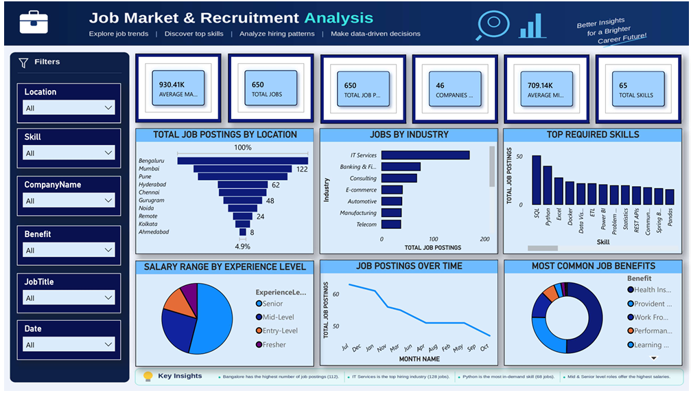

# Job Market Analysis Dashboard

## Project Overview
An interactive Power BI dashboard designed to analyze job market trends, employment opportunities, salary insights, and in-demand skills.

## Tools & Technologies
- Microsoft Power BI
- Power Query
- DAX
- Data Cleaning and Data Visualization

## Dashboard Preview

## Key Objectives
- Analyze job market trends.
- Understand the demand for different skills.
- Explore salary distributions.
- Identify employment opportunities.

## Project File
The Power BI dashboard source file is available in this repository.

**Author:** Akanksha Pawar