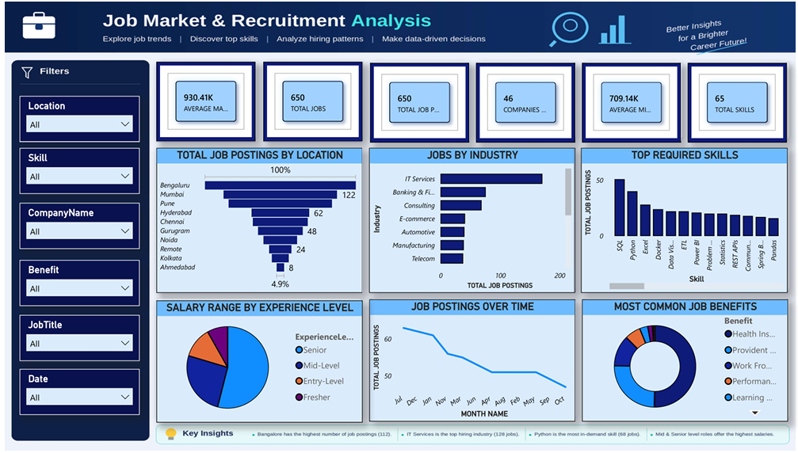

# Job Market Analysis Dashboard

## 📌 Project Overview

The Job Market Analysis Dashboard is an interactive Business Intelligence project developed using **Microsoft Power BI**. It focuses on exploring job market trends, employment opportunities, salary insights, and in-demand skills through interactive visualizations.

## 🛠️ Tools & Technologies

- Microsoft Power BI
- Power Query
- DAX (Data Analysis Expressions)
- Data Cleaning and Transformation
- Data Visualization

## 📊 Key Analysis Areas

- Job Market Trends
- Employment Opportunities
- Salary Analysis
- In-demand Skills
- Job Role Analysis

## 🎯 Project Objectives

- Analyze job market data to identify trends and patterns.
- Understand the demand for different skills.
- Explore salary distributions across job opportunities.
- Identify employment trends and opportunities.
- Present insights through interactive Power BI visualizations.

## 🖼️ Dashboard Preview

## 📁 Project File

The Power BI dashboard source file (`.pbix`) is available in this repository.

## 💡 Skills Demonstrated

- Data Analysis
- Data Cleaning and Transformation
- Power BI Dashboard Development
- Business Intelligence
- Data Visualization
- Analytical Thinking

## 👩‍💻 Author

**Akanksha Pawar**

[GitHub](https://github.com/AKANKSHASUBHASHPAWAR)
